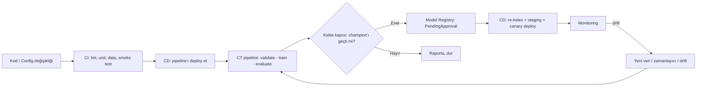

# ML İçin CI / CD / CT Best Practice'leri (IMAGE_RETRIEVAL Bağlamında)

## 0. Kavramlar: Klasik yazılımdan farkı

Klasik yazılımda sadece **kod** değişir. ML'de kod, **veri** ve **model** ayrı ayrı değişir. Bu yüzden döngü üç parçalıdır:

| Parça | Ne yapar? | Bu repodaki karşılığı |
| :--- | :--- | :--- |
| **CI** – Continuous Integration | Her commit'te kodu, **veriyi** ve **model mantığını** otomatik test eder | Yok |
| **CT** – Continuous Training | Yeni veri, kod veya tetikleyici geldiğinde modeli otomatik yeniden eğitir, değerlendirir ve kaydeder | `launch_sagemaker.py` ile elle başlatılıyor |
| **CD** – Continuous Delivery/Deployment | Hem **eğitim pipeline'ını** hem **onaylı modeli** (ve retrieval için **embedding index'ini**) otomatik olarak ortamlara çıkarır | Yok (henüz serving yok) |
| **CM** – Continuous Monitoring | Canlıdaki modeli izler; drift varsa CT'yi tetikler, döngüyü kapatır | Yok |

Google'ın MLOps olgunluk seviyeleri:
- **Seviye 0:** Manuel script'ler ve notebook'lar. Eğitim elle başlatılır, sonuçlar `.md`/`.json` dosyalarına yazılır. → **Repo şu an burada.**
- **Seviye 1:** Eğitim bir **pipeline** haline gelir ve otomatik tetiklenir (CT). Veri/model doğrulama, model registry ve metadata takibi vardır.
- **Seviye 2:** Pipeline'ın kendisi de CI/CD ile test edilip deploy edilir. Tam otomasyon.

---

## 1. CI Best Practice'leri

**Amaç:** Her PR'da hızlı (< ~10 dk), GPU gerektirmeyen ve deterministik testler çalışsın.

### 1.1 Kod kalitesi
- `ruff` (lint ve format), isteğe bağlı olarak `mypy`.
- `pre-commit` hook'ları ile aynı kontroller lokalde de çalışsın.
- **Secret scanning** (`gitleaks`). Şu an `config.yaml` içinde AWS hesap ID'si var.

### 1.2 Unit testler: ML mantığının doğruluğu
Bu repo için en değerli testler:
- **Loss:**
  - Tek pozitifli mükemmel hizalamada loss ≈ 0 olmalı.
  - K pozitifte taban ln(K) olmalı.
  - Loss simetrik olmalı.
- **Metrikler:** `ndcg`, `true_recall_at_k`, `reciprocal_rank` elle hesaplanmış bilinen örneklerle doğrulanmalı.
- **LoRA:**
  - `lora_B=0` başlangıcında çıktı base model ile birebir aynı olmalı.
  - Yalnızca beklenen parametreler `requires_grad=True` olmalı.
  - Kaydet/yükle round-trip'i aynı çıktıyı vermeli.
- **Dataset/collate:**
  - Eksik görseller doğru işlenmeli.
  - Batch alanları ve şekilleri doğru olmalı.

### 1.3 Veri testleri (ML'e özgü, çoğu zaman atlanan kısım)
- **Şema doğrulama** (`pandera` / Great Expectations):
  - Kolonlar ve tipler beklenen gibi olmalı.
  - `esci_label ∈ {E,S,C,I}` olmalı.
  - Null olmamalı.
- **Split leakage testi:**
  - Train/val/test arasında `query_id` kesişimi = 0 olmalı.
  - Ürün kesişim oranı raporlanmalı.
- **Dağılım kontrolleri:**
  - Etiket oranları beklenen aralıkta olmalı.
  - Sorgu başına aday sayısı beklenen aralıkta olmalı.

### 1.4 Smoke / integration testleri
- Küçük bir model (`hf-internal-testing/tiny-random-CLIPModel`) ve birkaç sahte görselle CPU'da 2–3 adım `train.py` çalıştırılmalı. Pipeline uçtan uca kırılmadan geçmeli.
- **"Tek batch'i ezberle" testi:** Loss birkaç adımda belirgin düşmeli. Bu test gradyan akışındaki hataları yakalar.

### 1.5 Ortam tekrarlanabilirliği
- Bağımlılıklar kilitlenmeli (`uv.lock` / `pip-tools`).
- Lokal, CI ve SageMaker **aynı Docker imajını** kullanmalı. Şu an container requirements'ları script içinde ayrıca tanımlı.
- Config bir şemayla doğrulanmalı (ör. `pydantic`). Yanlış yazılmış bir `best_metric` sessizce geçmemeli.

---

## 2. CT (Continuous Training) Best Practice'leri

### 2.1 Eğitimi bir pipeline'a dönüştürmek
Tek bir `train.py` yerine, her biri ayrı ve cache'lenebilir adımlar:

`prepare_data → validate_data → split → train → evaluate → compare_with_champion → register`

Araç seçenekleri: **SageMaker Pipelines** (mevcut altyapıya en yakın), Step Functions, Kubeflow/ZenML/Metaflow ya da basit başlangıç için GitHub Actions + `launch_sagemaker.py`.

### 2.2 Tetikleyiciler
- Ana branch'te model kodu veya config değişikliği
- Yeni veri versiyonu
- Zamanlayıcı (ör. haftalık)
- Monitoring'den gelen drift alarmı
- Manuel onay. GPU maliyeti nedeniyle bu proje için önemli.

### 2.3 Her şeyin versiyonlanması ve lineage
Her model için şu soruların cevabı kaydedilmeli: hangi **kod** (git SHA), hangi **veri** (hash/versiyon), hangi **config**, hangi **imaj** ile üretildi?
- **Veri:** DVC ya da S3'te değişmez, versiyonlu prefix'ler (`data/v3/...`) ve içerik hash'i.
- **Checkpoint:** `checkpoint.pt` içine `git_sha` ve `data_version` yazılmalı.

### 2.4 Experiment tracking
- Şu an sonuçlar `training_history_lr1e-05.json` ve elle yazılmış `.md` tablolarında tutuluyor.
- Bunun yerine **MLflow / W&B / SageMaker Experiments** kullanılmalı: parametreler, metrikler, artefaktlar ve karşılaştırma tek yerde olur.

### 2.5 Otomatik kalite kapısı (evaluation gate)
- Aday model, **sabit ve donmuş** test seti üzerinde mevcut **champion** ile karşılaştırılır.
- Kurallar önceden yazılır. Örnek:
  - Global NDCG@10 ≥ champion + δ
  - Hiçbir ana metrikte X puandan fazla gerileme yok
  - Zero-shot baseline geçilmiş olmalı
- Bootstrap güven aralığı kullanılırsa gürültüden kaynaklanan "iyileşmeler" elenir.
- Model seçimi **val** üzerinde yapılır; test yalnızca kapıda kullanılır.

### 2.6 Model Registry
- **SageMaker Model Registry** veya MLflow Registry kullanılabilir.
- Durumlar: `PendingManualApproval → Approved → Archived`
- CD yalnızca `Approved` modeli alır.

---

## 3. CD Best Practice'leri

ML'de CD'nin iki anlamı vardır:
1. **Pipeline'ın teslimi:** Değişen eğitim kodu, imaj ve pipeline tanımı otomatik olarak build edilip ECR/SageMaker'a çıkar.
2. **Modelin teslimi:** Onaylı model servise çıkar.

### 3.1 Retrieval'a özgü kritik nokta: Embedding index
- Model değişirse **tüm katalog görsellerinin embedding'leri yeniden hesaplanmalıdır**. Sorgu encoder'ı ile index **aynı model versiyonuna** ait olmalı.
- Bu nedenle deploy birimi "model" değil, **(model + index) çiftidir**:
  - **Batch embedding job:** SageMaker Batch Transform veya Processing ile yeni index oluşturulur.
  - **Index'e versiyon etiketi verilir.** Sorgu servisi uyumsuz bir index'e bağlanmayı reddeder.
  - **Blue/green:** Yeni model ve yeni index birlikte hazırlanır, trafik toplu olarak geçirilir. Geri dönüş tek bir switch ile yapılır.

### 3.2 Paketleme ve deployment
- LoRA ağırlıkları base modele **merge edilir**. Bu inference gecikmesini düşürür ve tek artefakt bırakır.
- Ortamlar: `dev → staging → prod`. Staging'de smoke ve latency testleri çalışır.
- Strateji seçenekleri: shadow, canary ya da blue/green. Otomatik rollback koşulları önceden tanımlanır.

---

## 4. Monitoring (Döngüyü Kapatan Kısım)
- **Operasyonel:** latency, hata oranı, maliyet.
- **Veri ve drift:**
  - Sorgu uzunluğu ve dil dağılımı
  - Sorgu ve görsel embedding dağılımındaki kayma
  - Yeni ürün kategorileri
- **Kalite:**
  - Online sinyaller (CTR, satın alma)
  - Periyodik olarak etiketlenen küçük bir örneklem
- Eşik aşıldığında CT pipeline'ı tetiklenir.

---

## 5. Altyapı ve Güvenlik
- **IaC:** S3, IAM rolleri, ECR ve SageMaker kaynakları Terraform/CDK ile tanımlanır. Şu an kaynaklar elle oluşturulmuş (`aws_commands.md`).
- **Kısa ömürlü kimlik bilgileri:** GitHub Actions'tan AWS'ye **OIDC** ile bağlanılır. Uzun ömürlü access key tutulmaz.
- **Maliyet koruması:** GPU job'ları yalnızca ana branch'te ve/veya manuel onayla çalışır. `MaxRuntime` sınırı ve bütçe alarmları tanımlanır.

---

## 6. Repo İçin Mevcut Durum vs. Hedef

| Alan | Şu an | Hedef |
| :--- | :--- | :--- |
| Lint/format | Yok | ruff + pre-commit + CI |
| Unit testler | Yok | loss, metrik, LoRA, dataset testleri |
| Veri doğrulama | Notebook'ta elle (`../datacheck.ipynb`) | Şema ve leakage testleri, pipeline adımı |
| Smoke test | Config'te `max_train_samples` ile elle | Tiny CLIP ile CI'da otomatik |
| Ortam | `requirements.txt` + script içinde ayrı container listesi | Lockfile + tek Docker imajı |
| Eğitim tetikleme | Elle `launch_sagemaker.py` | SageMaker Pipeline, tetikleyicilerle |
| Deney takibi | JSON + elle yazılmış `.md` | MLflow / W&B |
| Veri versiyonu | Yok | DVC veya versiyonlu S3 prefix |
| Model seçimi | Elle, kısmen test setine bakarak | Otomatik gate (val'de seçim, test'te kapı) |
| Model registry | S3 klasör isimleri | SageMaker Model Registry |
| Deploy / index | Yok | Batch re-index + versiyonlu blue/green |
| Monitoring | Yok | Drift ve latency → CT tetikleyici |
| Altyapı | Elle (CLI komutları) | Terraform/CDK + OIDC |

---

## 7. Önerilen Aşamalı Yol Haritası

1. **Faz 1 – CI temeli (en yüksek getiri, düşük maliyet):** ruff, pre-commit, pytest, veri ve leakage testleri, tiny-CLIP smoke testi, GitHub Actions, lockfile.
2. **Faz 2 – Tekrarlanabilirlik:** Tek Docker imajı, config şeması, git SHA ve veri versiyonunun checkpoint'e yazılması, MLflow/W&B.
3. **Faz 3 – CT:**
   - SageMaker Pipeline (validate → train → eval → gate → register)
   - Model Registry
   - Manuel onay adımı
4. **Faz 4 – CD ve monitoring:**
   - Merge edilmiş model + batch re-index
   - Versiyonlu index ile blue/green
   - Drift monitoring
   - IaC
